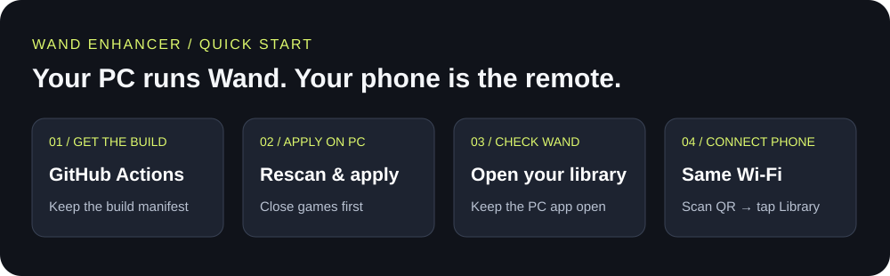
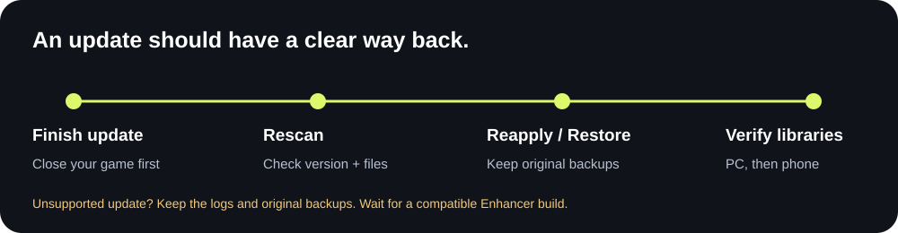

# Wand Enhancer · personal edition



A Windows companion for Wand, with a phone-friendly remote panel. This is [AshabaJasper's fork](https://github.com/AshabaJasper/Wand-Enhancer) of [k1tbyte/Wand-Enhancer](https://github.com/k1tbyte/Wand-Enhancer).

**Enhancer 2.1.1.0 · Wand 12.62.0 stable compatibility.** The previous build was verified on this Wand version with the normal library and five games syncing to the remote panel. This update adds safer support-file replacement and a mobile-first interface. [Compatibility evidence and test limits](docs/wand-12.62.0-compatibility.md).

## Get your build

1. Open [Actions → Build executable](https://github.com/AshabaJasper/Wand-Enhancer/actions/workflows/build.yml). To build independently, fork this repository first.
2. Choose **Run workflow**, select **master**, and leave release checks off for the default offline patcher.
3. Open the successful run and download **WandEnhancer-unsigned** under Artifacts. GitHub requires sign-in to download artifacts.
4. Extract the ZIP. Keep `WandEnhancer.exe` and `build-info.json` together.

The manifest records the source commit, executable version, SHA-256 and build link. The desktop header also shows the version and build. Use these to distinguish builds with the same version number. This fork does not distribute executables through video descriptions or third-party mirrors.

## Set up on your PC

1. Save your game and close it before changing Wand files.
2. Open `WandEnhancer.exe`. Check the detected **Wand version**; use **Rescan** after a Wand update, or select the installation folder yourself.
3. Read the support-file status. Choose **Choose changes…**, review the options, enable **Remote Web Panel**, and use **Static** for the configuration tested here.
4. Wait for the log to report completion. Open Wand and confirm your normal library loads.

Original archive and support-file backups are kept beside the installation. Keep them: **Restore** uses both. Only one Enhancer patch/restore operation may run for an installation at a time.

## Use your phone

1. Keep Wand open on the PC. Connect the phone and PC to the **same trusted Wi-Fi**.
2. Use the desktop **Connect** QR code, or open `http://YOUR-PC-LAN-IP:3223/remote/` on the phone. `127.0.0.1` only works on the PC itself.
3. Wait for **Connected**, then tap **Library** in the bottom navigation. Search your installed games and choose one.
4. Use **Settings** to reconnect or adjust the panel. Settings and Library stay reachable while scrolling; drawers fill narrow screens and controls are at least 44 pixels tall on phones.

For RDR2, load Story Mode before attempting a trainer. A connected library is **not** evidence of working gameplay: the earlier RDR2 trainer exit has not been resolved or retested.

The remote panel uses HTTP/WebSockets and has no pairing authentication. Anyone who can reach its port can control the active trainer. Keep it on a trusted LAN/private VPN; do not forward port 3223 to the internet. The panel does not expose your Wand bearer token or installation path through its protocol.

## After Wand updates



1. Let Wand finish updating, then close games before reapplying.
2. Open the latest Enhancer build and click **Rescan**. Check the newly selected Wand version.
3. If the launcher still has **Auto-apply after update** enabled, it attempts your saved selection when needed. Vendor updates can replace that launcher; automatic application is not guaranteed.
4. If changes are missing or the loading error returns, reapply to the newly detected version. Review the option selection before applying.
5. Open Wand, confirm its library loads, and reconnect the phone panel.

A future Wand release can change internals beyond this build's locators. A failed compatibility check should be treated as unsupported until investigated, not bypassed.

### Recovery messages

| What you see | What to do |
| --- | --- |
| Recovery needed / previous change did not finish | Close games and Wand. Reapply, or use Restore to return to the original files. |
| Support files missing or wrong size | Preserve both backups. Restore a complete original installation or repair/reinstall Wand if the backups are also damaged. |
| Could not replace support files safely | A file may be locked. Close Wand and games, then retry. The prepared replacement is copied before the live directory is moved. |
| Another operation may be running | Wait for the current patch/restore to finish; do not run two copies against the same installation. |
| Phone cannot load the page | Check the LAN address, same network and router client isolation. Review the existing private-network firewall rule for TCP 3223; do not disable antivirus or firewall protection. |
| Panel shows Offline | Keep Wand open, check its normal library first, then use Settings → Connect. |

If recovery fails, retain `launcher.log` and `launcher.prev.log` from the Wand root and export the desktop log. Redact account information and personal paths before sharing. Include Wand version, Enhancer build, selected options, and whether this followed an update.

## What changed in 2.1.1

- Prepare support files in a separate folder before swapping them into place; recover an interrupted directory swap on retry.
- Cover preparation failures with the patch rollback path and prevent overlapping operations.
- Show detected Wand version, support-file health, recovery guidance and a Rescan action.
- Make the remote panel mobile first: larger text and touch targets, full-width phone drawers, persistent labelled navigation, safe-area spacing and clearer connection states.
- Refresh and strictly compile translation catalogs during builds; untranslated new labels fall back to readable English.
- Include a build identity manifest in the GitHub Actions artifact.

These safeguards reduce known failure modes. They cannot guarantee compatibility with every future Wand update, disk failure, locked file or game trainer.

## Build and test locally

Requirements: Windows, Node.js, pnpm, Visual Studio 2022/Build Tools with MSBuild, and .NET Framework 4.8 desktop targeting tools.

```powershell
./build.cmd
```

The build lints and type-checks the web panel, builds production assets, runs web tests, builds WPF, and exercises desktop/patch-locator fixtures. Fixtures use temporary directories. For web development:

```powershell
pnpm --dir web-panel install --frozen-lockfile
pnpm --dir web-panel dev
```

The development page connects to the running local bridge on port 3223. Production output contains no demo trainer. [UI acceptance and remaining limits](docs/ui-acceptance.md).

`build.cmd -EnableUpdateNotifications` compiles optional GitHub release notifications. Default builds exclude that network code. The optional variant sends ordinary GitHub API request metadata and opens release notes; it does not download or install updates. Wand itself is online; the remote panel uses Wand API/CDN data for artwork/translations. Browser preferences and pins are stored locally.

## Custom scripts

With Remote Web Panel enabled, add trusted `.js` files in the patch dialog or a `renderer-scripts` folder beside the executable. They run inside Wand's renderer with Node access and may run more than once; guard one-time setup. Do not add scripts you do not understand.

## Credits and license

Original project by [k1tbyte](https://github.com/k1tbyte/Wand-Enhancer). Personal usability and recovery changes maintained in this fork. [Apache-2.0 license](LICENSE.md). This is an independent project, not an official Wand product.
